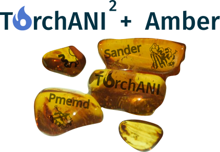

<div align="center">
<picture>
  <source media="(prefers-color-scheme: dark)" srcset="https://raw.githubusercontent.com/roitberg-group/torchani-amber/main/ani-amber-logo-dark.png">
  <source media="(prefers-color-scheme: light)" srcset="https://raw.githubusercontent.com/roitberg-group/torchani-amber/main/ani-amber-logo-light.png">
  
</picture>
</div>
<br>

[](https://doi.org/10.5281/zenodo.17273338)
[](https://opensource.org/licenses/MIT)

Interface enabling molecular dynamics or minimizations with ANI-style NN-IPs (neural
network interatomic potentials) *and other general NN-IPs*, in the Amber software suite.
Energies and forces are calculated with the deep NNs at each step of the simulation,
and propagated by the MD engine.

Different modes are available, allowing for both "full ML" simulations, and simulations
where intermolecular non-bonded interactions are calculated by the force field. ML/MM
simulations are also possible. Both `sander` and `pmemd` are supported.

TorchANI-Amber has been tested with the latest `AmberTools` and `pmemd` versions (2026).
Apply all patches with `update_amber` before building Amber.

If you find this work useful please cite the following articles:
- *TorchANI-Amber: Bridging neural network potentials and classical biomolecular simulations* <br>
    https://doi.org/10.1021/acs.jpcb.5c05725 
- *TorchANI 2.0: An extensible, high performance library for the design, training, and use of NN-IPs* <br>
    https://pubs.acs.org/doi/10.1021/acs.jcim.5c01853
- *TorchANI: A Free and Open Source PyTorch-Based Deep Learning Implementation of the ANI Neural Network Potentials* <br>
    Original TorchANI implementation: https://pubs.acs.org/doi/10.1021/acs.jcim.0c00451
- *Advancing Multiscale Molecular Modeling with Machine Learning-Derived Electrostatics* <br>
    For the ML/MM capabilities: https://pubs.acs.org/doi/10.1021/acs.jctc.4c01792

Built-in models are:
- [ANI-1x](https://aip.scitation.org/doi/10.1063/1.5023802)
    (wB97X) Supports H, C, N, O elements. No charged systems
- [ANI-2x](https://pubs.acs.org/doi/10.1021/acs.jctc.0c00121)
    (wB97X) Supports H, C, N, O, S, F, Cl elements. No charged systems
- [ANI-1ccx](https://www.nature.com/articles/s41467-019-10827-4)
    (wB97X) Supports H, C, N, O, S, F, Cl elements. No charged systems

The modified TorchANI 2 models:
- [ANI-2xr](https://chemrxiv.org/engage/chemrxiv/article-details/6890d92523be8e43d6b9bbba)
  (wB97X) Supports H, C, N, O, S, F, Cl elements. No charged systems. Includes
  repulsive interactions and smooth PES
- [ANI-2dr](https://chemrxiv.org/engage/chemrxiv/article-details/6890d92523be8e43d6b9bbba)
    (B973c) Supports H, C, N, O, S, F, Cl elements. No charged systems. Includes
    repulsive interactions, D3, and smooth PES

Other NN-IPs supported out of the box:
- [AimNet 2](https://pubs.rsc.org/en/content/articlelanding/2025/sc/d4sc08572h)
    Both wB97M-D3BJ and B973c are supported, with and without DSF.
- [Nutmeg](https://pubs.rsc.org/en/content/articlelanding/2025/sc/d4sc08572h)
    Small, medium and large are supported (wB97M-D3BJ)

Including your custom NN-IP is simple if you follow the TorchANI 2 API

## Installing from source

Useful links:

- [Download the AmberTools source distribution](https://ambermd.org/AmberTools.php)
- [Download the NVIDIA CUDA Toolkit](https://developer.nvidia.com/cuda-downloads)
- [Miniconda and Mamba releases](https://conda-forge.org/miniforge/)
- [Official PyTorch installation instructions](https://pytorch.org/get-started/locally/)

The main supported way to build and install the TorchANI-Amber interface is with
`cmake`, from within a `conda` (or `mamba`) environment. The necessary steps are
described next. Other procedures may work, but are untested. GCC >= 12.2 is required.

TL;DR installation instructions:

```bash
git clone --recurse-submodules git@github.com:roitberg-group/torchani-amber.git
cd torchani-amber
conda env create --file ./environment.yaml
conda activate ani-amber
./run-cmake
# Build Amber adding the following flags: -DCMAKE_PREFIX_PATH=$HOME/.local/, -DCOMPILER=GNU
# Make sure torchani appears in the list of enabled software when running cmake
conda deactivate ani-amber
```

More detailed installation instructions:

1. Clone this repo and cd into it
    ```bash
    git clone --recurse-submodules git@github.com:roitberg-group/torchani-amber.git
    cd torchani-amber
    ```
2. Create a new `conda` (or `mamba`) environment and activate it. The `environment.yaml`
    file has a correct environment, tested to work correctly with TorchANI-Amber. It
    contains:
    - TorchANI's required dependencies, including PyTorch
    - CUDA Toolkit libraries necessary to build the extensions and interface
    - GFortran and OpenMPI, which are needed to compile Sander and Pmemd (serial and MPI)
    ```bash
    conda env create --file ./environment.yaml
    conda activate ani-amber
    ```
3. Install TorchANI (python), *without* its compiled extensions (they are built in the
    next step)
    ```bash
    pip install --no-deps --no-build-isolation -v -e ./submodules/torchani
    ```

4. Build and install TorchANI-Amber using the `run-cmake` script
    This also builds the TorchANI extensions (cuAEV, MNP and the cell list), places them
    inside the TorchANI python package, and then JIT-compiles the models.
    *ADVANCED:* If you want to perform your custom modifications to the build, this is
    the moment to do it. Check `run-cmake` and the `CMakeLists.txt` for more info.
    By default the installation script runs the tests (which are fast), you can avoid
    this by using the `-T` flag. For more options do `run-cmake -h`.
    ```bash
    ./run-cmake
    ```
    By default the extensions are built for the GPUs detected in the current node. If
    you don't have access to a GPU currently (e.g. you are compiling in a node without
    a GPU and you want to afterwards run in a node with a GPU) use `./run-cmake -a` to
    build for many GPU architectures (it will take significantly longer)
5. Compile Amber from source. Amber will automatically find TorchANI-Amber and link it
   to both `pmemd` and `sander`. You can refer to [the amber
   website](https://ambermd.org/) for info on how to obtain and install Amber. You can
   use this cmake configuration as a template to generate the buildsystem.
    ```bash
    cmake \
        ...
        -DCMAKE_PREFIX_PATH=$HOME/.local/
        -DCOMPILER=GNU
        ...
    ```
    After this is done, you can safely deactivate the environment, it is no longer
    needed. However, *don't remove it*. The compiled binaries will depend on the cuda
    and torch dynamic libraries in the env to run correctly.
    ```bash
    conda deactivate ani-amber
    ```
<!-- Is it a problem to use amber's miniconda / python? maybe not? -->

IMPORTANT: If you compile `sander` or `pmemd` with TorchANI-Amber enabled, the
`sander|pmemd` binaries *will depend on the torchani libraries being present to run
correctly*. This is true even when running CPU-only calculations, or calculations that
don't use torchani at all.

When building Amber make sure the install prefix for `TorchANI-Amber` is in the `cmake`
search path. If `TorchANI-Amber` was installed to `~/.local/lib` (the default, which
doesn't need `sudo`). you may need to add `CMAKE_PREFIX_PATH=${HOME}/.local/`. If this
is correctly done, then `Torchani` will show up in the list of enabled software that
Amber prints when installing.

## CPU-only support

TorchANI-Amber can run CPU-only. By default it is built with CUDA support, and in this
case it depends on the CUDA Toolkit and LibTorch even when running on CPU.

To build without any CUDA dependency use `./run-cmake -c` (or configure with
`-DTORCHANI_BUILD_CUDA=OFF`). This requires a CPU-only PyTorch (or LibTorch), e.g.
installed with `pip install torch --index-url https://download.pytorch.org/whl/cpu`,
and the `nvidia::cuda-toolkit` dependency in `environment.yaml` is not needed. The
resulting build can't use CUDA devices or the cuAEV CUDA kernels.

When running on CPU, set `export OMP_NUM_THREADS=1` before calling Sander or Pmemd. By
default LibTorch (and OpenBLAS, if Amber links against it) spawn one thread per core,
and the resulting oversubscription can make dynamics more than 10x slower.

## Usage

Familiarity with Amber, Pmemd and/or Sander is assumed in what follows.

To use TorchANI-Amber to run full-ML simulations, you need two different namelists in
your input file:
- The usual `&cntrl` namelist, which *must have* the flag `imlip = 1`, together with
  the usual simulation configuration.
- Second, the `&mlip` namelist, with the actual `TorchANI` configuration.

The `&mlip` namelist supports the following basic options:
- `model_type` (*string*)
   The neural network to choose. Possible values are `"ani1x"`, `"ani1ccx"`, `"ani2x"`,
   `"ani2dr"`. For usage of custom models see section *Support for custom
   models*. Default is `"ani2x"` (case sensitive).
- `use_double_precision` (*bool*)
   Determines whether the network runs using float64 parameters. Defaults to `.true.` We
   recommend this setting for accurate dynamics.
- `use_cuda_device` (*bool*)
   Determines whether the network runs in a CUDA enabled GPU. Default is `.true.`. If
   the flag is set to `.true.` and a CUDA enabled GPU can't be found, TorchANI-Amber
   will exit with an error. CUDA acceleration provides a very significant performance
   boost over CPU.
- `ml_charge` (*int*)
   Total charge of the system evaluated by the model. Default is `0`. Not all models
   support charged systems.
- `ml_spin_mult` (*int*)
   Spin multiplicity of the system evaluated by the model. Default is `1`. Not all
   models support spin multiplicities other than `1`.

There are also some advanced options:
- `use_cuaev` (*bool*)
   Whether to use the cuAEV compiled extension to accelerate potentials that support it.
- `use_external_neighborlist` (*bool*)
   Whether to let Sander | Pmemd handle the neighborlist calculation.
- `use_external_nonbond` (*bool*)
   Whether to let Sander handle all inter-molecular non-bonded interactions. See
   section *Amber-NB configuration*. Default is `.false.`.
- `model_index` (*int*)
   Select a specific model (0-indexed) from a model ensemble. The default is to use the
   whole ensemble (set to -1). We recommend you do *not* set this flag unless you know
   exactly what you are doing. Using an ensemble provides a significantly higher
   accuracy than using a single model.
- `cuda_device_index` (*int*)
   The index of the CUDA enabled GPU. If `use_cuda_device` is `.true.` then it can be
   set to a (0-indexed) device integer. By default it is set to `0`. It only makes sense
   to change this flag if you can access more than one CUDA enabled GPU in your machine.

Output related options:
- `write_coords` (*bool*)
   Dump the coordinates of the atoms evaluated by the model as a `.xyz` file
- `write_forces` (*bool*)
   Dump the forces calculated by the model as a `.dat` file
- `write_atomic_charges` (*bool*)
   Dump the atomic charges predicted by the model as a `.dat` file. Requires a
   charge-predicting model
- `write_interval` (*int*)
   The outputs are written every `write_interval` MD steps. Default is `1`
- `output_dir` (*string*)
   Directory of the output files. Default is the current working directory

The files are `coords.xyz`, `forces.mlip.dat` and `atomic_charges.mlip.dat`. For
ML/MM, they are named `ml_region.xyz`,
`forces_ml_region.mlip.dat` (and `forces_mlmm_mm_region.mlip.dat` for the MM atoms)
and `atomic_charges_ml_region.mlip.dat`.

An example `mdin` input file with the correct format:

```
&cntrl
    imlip = 1  ! Required to run full-ML TorchANI-Amber
    ! ... Add the rest of the Sander options here
/
&mlip
    model_type = "ani2x"
    use_double_precision = .true.
    use_cuda_device = .true.
    use_cuaev = .true.
    ! ... Add the rest of the TorchANI-Amber config options here
/
```

## Amber-NB configuration

In the Amber-NB configuration, the NN-IP only calculates the *intra-molecular*
interactions, and all *inter-molecular* non-bonded interactions (van der Waals and PME
electrostatics) are calculated by the force field. Molecules are defined by the
`ATOMS_PER_MOLECULE` section of the topology file. This configuration is useful, for
example, for memory-hungry models, or for offloading long range interactions to the FF.

To use it, set `use_external_nonbond = .true.` in the `&mlip` namelist of a full-ML
input. The other namelists stay the same.
Pmemd is (currently) not supported for this configuration. Periodic boundary conditions
(`igb = 0`) are required.

An example `mdin` input file for the Amber-NB configuration is, schematically:

```
&cntrl
    imlip = 1  ! Required to run full-ML TorchANI-Amber
    cut = 8.0  ! Cutoff for the inter-molecular FF non-bonded interactions
    ! ... Add the rest of the Sander options here
/
&mlip
    model_type = "ani2x"
    use_external_nonbond = .true.  ! Required for the Amber-NB configuration
    use_double_precision = .true.
    use_cuda_device = .true.
    use_cuaev = .true.
    ! ... Add the rest of the TorchANI-Amber config options here
/
```

For a full example see `inputs/ala-dipep-fullml-ani2x-nb/`.

## Usage of the interface for ML/MM

TorchANI-Amber is also integrated with the QM/MM Sander subsystem, which means you can
perform ML/MM simulations with it. Sander is *required* for this, Pmemd is not
supported.

If you want to run this kind of dynamics, **instead** of setting `imlip = 1` and
including the `&mlip` namelist, you should set `ifmlmm = 1` in the `&cntrl` namelist,
and include the `&mlmm` namelist. The `&mlmm` namelist replaces both the `&mlip` and the
`&qmmm` namelists: it accepts all the `&mlip` options, and Sander sets up its QM/MM
subsystem from it. A `&qmmm` namelist can't be used together with `&mlmm`, and
`ifmlmm = 1` can't be used together with `ifqnt = 1`.

The `&mlmm` namelist supports, in addition to the `&mlip` options:
- `ml_mask` (str)
   Amber mask that selects the ML region (e.g. `':1'`). It has no default, if it is not
   set the ML region is empty and Sander stops with an error.
- `mm_cutoff = 15.0` (double)
   Cutoff (in Angstrom) of the MM atoms that interact with the ML region. It can't be
   set with `mlmm_coupling = 'mechanical-embedding'`.
- `ml_shake = .true.` (bool)
   Whether the bonds to hydrogen within the ML region are constrained by SHAKE (only if
   SHAKE is turned on with `ntc > 1`).
- `ml_charge = 0` and `ml_spin_mult = 1` (int)
   Charge and spin multiplicity of the ML region. Sander also uses the charge (e.g. to
   adjust the MM charges so that the total charge is preserved).

ML/MM and electrostatic related options:
- `use_mlip_atomic_charges` (bool)
   **This option can only be specified if a charge-predicting model is selected.**
   Currently the `model_type`s that support it are `animbis` and `aimnet2-*-mbis-*`.
   Partial charges for the QM atoms will be predicted by TorchANI (MBIS atomic charges at
   the `wB97X/def2-TZVPP` level of theory, *in vacuo*, for ANI-mbis) in each step. These
   charges are geometry-dependent, and the derivatives w.r.t. coordinates are used to
   calculate their contribution to the forces.
- `mlmm_coupling` (str, case-insensitive)
   Currently available are: `'coulombic'` (*coulombic coupling*, the default),
   `'simple-polarizable'` (*simple polarizable* coupling), `'custom'` (custom ML/MM model,
   see below), `'none'` (no ML/MM coupling) and `'mechanical-embedding'` (or `'me'`).
   With `'mechanical-embedding'`, Sander calculates the ML/MM interaction with the force
   field, using the topology charges of the ML region, and the MLIP only calculates the
   energy of the ML region in vacuo. In this case `use_mlip_atomic_charges` and
   `use_mlip_atomic_volumes` must be `.false.`, and periodic boundary conditions
   (`igb = 0`) are required.

We recommend using one of the following two settings:
- *mlmm_coupling = 'simple-polarizable'* and *use_mlip_atomic_charges=.true.* (variable
  nn-predicted charges)
- *mlmm_coupling = 'coulombic'* and *use_mlip_atomic_charges=.false.* (fixed topology
  charges)

A template for the first setting (simple polarizable with variable charges) is:

```raw
&cntrl
    ifmlmm = 1  ! Required for all ML/MM TorchANI-Amber dynamics
    ! ... Add extra simulation settings here
/
&mlmm
    ml_mask = ':1'  ! Select the first molecule as the ML region
    ml_charge = 0  ! Charge of the ML region
    ml_spin_mult = 1  ! Spin multiplicity of the ML region
    mm_cutoff = 15.0  ! Recommended
    model_type = 'animbis'  ! Charge-predicting model, 'animbis' or 'aimnet2-*-mbis-*'
    use_mlip_atomic_charges = .true.  ! Use geometry dependent, nn-predicted charges
    mlmm_coupling = 'simple-polarizable'  ! Simple polarizable coupling
    ! ... Add the rest of the TorchANI-Amber config options here
/
```

An example of the second (coulombic with fixed charges, i.e. mechanical embedding):

```raw
&cntrl
    ifmlmm = 1  ! Required for all ML/MM TorchANI-Amber dynamics
    ! ... Add extra simulation settings here
/
&mlmm
    ml_mask = ':1'  ! Select the first molecule as the ML region
    mm_cutoff = 15.0  ! Recommended
    model_type = 'ani2x'  ! Select any model
    use_mlip_atomic_charges = .false.  ! Use fixed topology charges
    mlmm_coupling = 'coulombic'  ! Coulombic coupling
    ! ... Add the rest of the TorchANI-Amber config options here
/
```

Many experimental options are also available for ML/MM. Please don't use experimental
options unless you are a developer or you know exactly what you are doing, they are not
extensively tested and we make no guarantees or claims regarding the results obtained
with them. For more information consult the [ML/MM developer
notes](/README_MLMM_DEV.md).

## Limitations

The following are not yet supported, although it is possible that some of these
limitations will be lifted in the future:

- Implicit solvent Generalized Born dynamics. Only `igb = 0` (PBC) and `igb = 6` (no
  PBC, vacuum) are supported.
- Constant pH and constant redox potential dynamics
- Thermodynamic integration (TI)
- External electric fields
- Berendsen barostat for NPT dynamics.

## Support for custom models

Custom models are supported by passing a full path to the jit-compiled file to
`model_type`. Custom models must fullfil some API requirements.

The easiest way to fullfil requirements needed for usage of custom models is for your
model to be an instance of `ANI` or `ANIq`. This is flexible, since they are highly
customizable.

Alternatively, subclassing `ANI` or `ANIq` and overriding `compute_from_neighbors(...)`
is also supported. This is more complex. Consult the `TorchANI 2` source code for a
reference implementation of `compute_from_neighbors`. `use_cuaev` and `network_index`
may not be supported in this case, depending on your model.

*ADVANCED*: AOTInductor-compiled, exported models (PyTorch 2 compilation method) are supported
on an experimental basis. Support will improve as PyTorch's 2 support improves.
The easiest way to generate a compliant AOTI package is to use
`torchani.compile.compile_model(...)` on your model, passing the supported
configurations as arguments. Consult the `torchani` documentation for more info.

*ADVANCED*: The exact requirements are as follows. If the model outputs atomic energies,
`forward` must have the following signature:

```python
def forward(
    self,
    species_coords: tuple[Tensor, Tensor],
    cell: Tensor | None = None,
    pbc: Tensor | None = None,
    charge: Tensor | None = None,  # Net charge per molec, shape: (1,) for single molec
    atomic: bool = False,  # Controls atomic energy decomposition
    ensemble_values: bool = False,  # Controls whether the model outputs ensemble values
    molecule_idxs: Tensor | None = None,  # Can be used if your mlip needs
) -> tuple[Tensor, Tensor, Tensor]:
    # Where the output is a tuple:
    #     - species (shape: [1, atoms])
    #     - energies (shape: [1,])
    #     - atomic_charges (shape: [1, atoms])
    # For more information about the signature consult the `TorchANI 2` docs
    # and source code.
    ...
    return species, energies, atomic_charges
```

If the model doesn't support atomic charges, the signature is the same, but with
`tuple[Tensor, Tensor]` instead, omitting `atomic_charges`.

`charge` is an `int64` tensor with one entry per molecule (the first dim of the
coords).

If you want to use the internal Amber neighborlists, your should additionally
support the following method:

```python
@torch.jit.export
def compute_from_external_neighbors(
    self,
    species: Tensor,
    coords: Tensor,
    neighbor_idxs: Tensor,  # External neighbors
    shifts: Tensor,  # External shifts that have to be applied to wrap PBC
    charge: Tensor | None = None,  # Net charge per molec, shape: (1,) for single molec
    atomic: bool = False,
    ensemble_values: bool = False,
    molecule_idxs: Tensor | None = None,  # Can be used if your mlip needs
) -> tuple[Tensor, Tensor | None]:
    # Where the output is a tuple:
    #     - energies (shape: [1,])
    #     - atomic_charges (shape: [1, atoms]) (or None)
    ...
    return energies, atomic_charges
```

*EXPERIMENTAL*: If you want to use the 'switching' feature, the model should correctly
respect the `ensemble_values` contract. Energies and atomic charges must have
an extra dim prepended in this case, which indexes the models in the network.

## Tests

To run the `Amber` integration tests run `pytest -v ./tests/test_sander.py` (a working Sander
binary is assumed to be on `PATH`). This will run CPU and CUDA tests for the ML/MM
and Full-ML Amber integrations.

## Debug logging

The C++ library logs debugging information (model path, atomic numbers, initialization
steps, and the wall time of each energy and force calculation) using LibTorch's
built-in logging. These messages are hidden by default. To print
them set `TORCH_CPP_LOG_LEVEL` environment variable when running Amber:

```bash
TORCH_CPP_LOG_LEVEL=INFO sander -O -i md.in ...
```

Valid values are `INFO`, `WARNING` (default), `ERROR` and `FATAL`. This also
enables LibTorch's own messages.

## Notes on LibTorch (C++) and PyTorch (Python) compatibility when using TorchScript

**NOTE**: This is a non-issue if you use the normal installation instructions,
but it may be an issue if you use your own custom approach or models.

If using TorchScript, it is important that the models used are JIT-compiled using the
same PyTorch version as the LibTorch version linked to the libraries. For example, if
`torch.__version__ == 2.13` when compiling JIT'ed models, then the linked LibTorch must
also be 2.13, otherwise LibTorch may fail to load the models, or load them incorrectly.

## Support for custom ML/MM models

This functionality was added with the help of Kirill Zinovjev. For usage
examples see the [EMLE-engine repository](https://github.com/chemle/emle-engine)
and the corresponding [EMLE-engine article](https://pubs.acs.org/jctcce/article/20/11/4514/169286/emle-engine-A-Flexible-Electrostatic-Machine).

Custom ML/MM models, which calculate both the in-vacuo energy and the ML/MM coupling
internally, are supported by setting `mlmm_coupling = 'custom'`. Forces on the ML and MM
regions are calculated by autograd from the returned energy. The model must support the
following method:

```python
@torch.jit.export
def compute_mlmm(
    self,
    species_coords: tuple[Tensor, Tensor],
    mm_coords: Tensor,  # MM coordinates (shape: [1, mm-atoms, 3])
    mm_charges: Tensor,  # MM charges (shape: [1, mm-atoms])
    cell: Tensor | None = None,
    pbc: Tensor | None = None,
    charge: Tensor | None = None,  # Net charge per molec, shape: (1,) for single molec
    spin_mult: Tensor | None = None,  # Spin multiplicity per molec, shape: (1,)
    mm_cutoff: Tensor | None = None,  # MM cutoff per molec, shape: (1,)
    atomic: bool = False,  # Controls atomic energy decomposition
    ensemble_values: bool = False,  # Controls whether the model outputs ensemble values
    molecule_idxs: Tensor | None = None,
) -> Tensor:
    # Where the output is:
    #     - energies, in-vacuo + ML/MM coupling (shape: [1,])
    ...
    return energies
```

If the model supports atomic charges, the signature is the same, but the output is
the tuple `(energies, atomic_charges)` instead, with `atomic_charges` of shape
`(1, atoms)` for a single molecule.
`spin_mult`: `int64` tensor with the spin multiplicity of each molecule (default 1).
`mm_cutoff`: float tensor with the MM cutoff of each molecule (default 0).

Units are Angstrom for coordinates, elementary charge for charges, and Hartree for
energies. Currently Amber always calls `compute_mlmm` with `cell = None`,
`pbc = None`, `spin_mult = 1`, `mm_cutoff = 0`, `atomic = False` and
`ensemble_values = False`.
